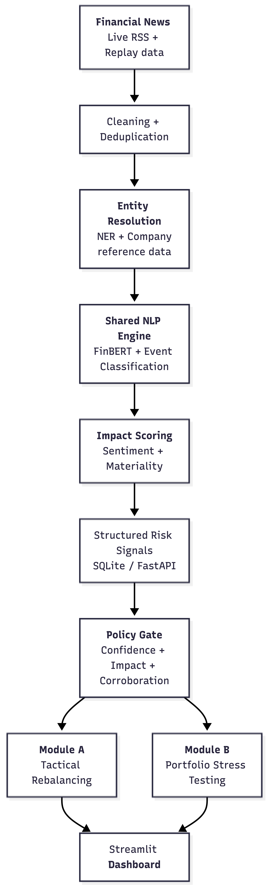

# Explainable AI/NLP Financial Risk Intelligence Platform

**S&P Global & CRISIL | Hackathon 2026**


**Candidate:** Umang Aggarwal


**College:** Indraprastha Institute of Information Technology Delhi (IIIT-Delhi)


**Demo video:** `To be added after recording`


**Presentation deck:** `docs/presentation.pdf`

## 1. Project Overview

Financial institutions receive a continuous stream of unstructured financial news. The challenge is not only to identify whether an article is positive or negative, but to determine whether it represents a material, corroborated risk to a portfolio.

This project implements an explainable financial-risk prototype that converts financial news into structured risk signals. The shared AI/NLP engine cleans and deduplicates articles, resolves companies to tickers, scores financial sentiment, classifies events, and calculates an impact score. The resulting signals are consumed by two downstream applications:

- **Module A — Tactical Index Rebalancing:** adjusts mock index weights according to sentiment while applying turnover controls.
- **Module B — Strategic Portfolio Stress Testing:** applies illustrative event-driven shocks to a synthetic multi-asset wholesale portfolio.

The prototype does not treat every negative-sounding article as a portfolio shock. Each article is first converted into a structured signal containing the affected company, event type, sentiment, confidence, and impact score. A signal can remain visible for review without being allowed to change portfolio valuations. Before Module B runs a stress test, the signal must pass a policy gate: it must be sufficiently severe, have adequate model confidence, and be supported by at least two independent sources.

The replay data illustrates this distinction. One article reports a rumor about new Apple Watch accessory colors. The engine identifies Apple and records the article, but classifies it as a low-impact product rumor; it is therefore displayed as analyzed information and excluded from the formal stress-test workflow.
Two separate reports from Reuters and Bloomberg describe Boeing credit deterioration, including a rating downgrade, liquidity pressure, and higher default risk. Because this event is materially relevant to the synthetic portfolio and is corroborated by two independent sources, it passes the policy gate. Module B then applies illustrative credit shocks and shows how the event affects portfolio value and loss by asset class.

## 2. Architecture and Tech Stack

<p align="center">
  
</p>

The processing flow is:

```text
Live RSS or Deterministic replay data
    → cleaning and deduplication
    → entity resolution and optional NER
    → FinBERT sentiment and event classification
    → explainable impact scoring
    → structured risk signal store
    → corroboration and policy gate
    → Module A / Module B
    → Streamlit dashboard
```

The repository also exposes the structured signals through an optional FastAPI service.

### Main technologies

- **NLP:** PyTorch, Hugging Face Transformers, `ProsusAI/finbert`, `dslim/bert-base-NER`
- **Event classification:** Hybrid domain rules and optional zero-shot NLI classification
- **Backend:** FastAPI, Pydantic, SQLite, Uvicorn
- **Dashboard:** Streamlit and Plotly.
- **Data processing:** Pandas and NumPy
- **Testing:** Pytest

## 3. Data Used

### Project data

- `data/reference/security_master.json` — curated company, ticker, alias, sector, beta, and rating reference data.
- `data/portfolios/synthetic_portfolio.json` — synthetic wholesale portfolio containing equities, bonds, loans, and interest-rate swaps.
- `data/demo/replay_feed.json` — deterministic multi-source scenarios for reproducible demonstrations, including Boeing credit reports, macroeconomic events, regulatory events, and low-materiality rumors.
- `data/demo/users_profiles.json` — synthetic demo users, watchlists, and assigned portfolios.
- `data/evaluation/evaluation_samples.json` — compact manually labeled evaluation fixture.

### External and live sources

- **Live RSS:** CNBC Markets, Yahoo Finance, and MarketWatch.
- **Financial PhraseBank:** local labeled sentiment data used to evaluate FinBERT on a balanced 60-sentence subset.
- **US Financial News Articles:** a compact 30-record unlabeled JSON sample used for ingestion and cleaning validation.

The portfolio, user profiles, security reference data, replay scenarios, and stress parameters are synthetic or curated for demonstration. No proprietary or confidential client data is used.

## 4. Quickstart

### Requirements

Python 3.10 or newer. The application and test suite were validated on Python 3.14 on macOS.

### Installation

```bash
git clone https://github.com/umang23567/IIIT-Delhi-Umang-Aggarwal-Hackathon.git
cd IIIT-Delhi-Umang-Aggarwal-Hackathon

python3 -m venv venv
source venv/bin/activate
pip install -r requirements.txt
```

On Windows, activate the environment with:

```powershell
venv\Scripts\activate
```

### Run the dashboard

```bash
python main.py
```

Then open `http://localhost:8501`.

The dashboard's **Demo data** toggle controls the input mode:

- **On:** uses deterministic replay scenarios.
- **Off:** fetches current articles through the configured CNBC, Yahoo Finance, and MarketWatch RSS adapters.

### Run the optional API

```bash
uvicorn src.api.server:app --reload --port 8000
```

### Run the tests

```bash
PYTHONPATH=. pytest tests -q
```

## 5. Policy and Stress-Testing Logic

Module B permits formal stress execution only when the signal satisfies:

```text
Impact score ≥ 7.0
Confidence ≥ 0.65
At least 2 independent corroborating sources
```

The stress engine uses simplified, explainable sensitivities:

- Equities: market-value and beta shocks.
- Bonds: duration and credit-spread shocks.
- Loans: EAD, PD, and LGD expected-loss changes.
- Swaps: DV01 and interest-rate shocks.

These are illustrative prototype assumptions, not calibrated production or regulatory stress parameters.

The governance workflow is inspired by SR 11-7 model-risk and BCBS 239 data-lineage principles. The policy gate, corroborating-source requirement, structured signal persistence, and evidence lineage are presented as auditable prototype controls, not as a claim of regulatory compliance or certification.

## 6. Evaluation Results

### Financial PhraseBank sentiment evaluation

FinBERT was evaluated on a balanced subset of 60 labeled sentences:

```text
20 positive | 20 negative | 20 neutral
```

Observed accuracy:

```text
81.7%
```

This is a small accuracy evaluation and should not be interpreted as general or production model accuracy.

### US Financial News ingestion evaluation

The US Financial News JSON data was used as an unlabeled ingestion test. Records were converted into the internal article schema and checked for text cleaning and source preservation. Because the data does not provide gold sentiment or event labels, no classification accuracy is claimed.

### Automated tests

The separated test suite covers cleaning, persistence, entity resolution, event classification, impact scoring, corroboration, replay processing, stress testing, and evaluation fixtures.

Latest full run:

```text
14 passed
```

The suite includes an ingestion test for the US Financial News Articles sample. It converts 30 external records into the internal article format, cleans them successfully, and preserves their source information. The sample does not measure model accuracy because the collection has no gold sentiment or event labels.

## 7. Prototype Scope and Next Steps

This submission focuses on demonstrating the complete path from financial news to explainable portfolio risk. To keep that demonstration reproducible, the project uses curated reference data, synthetic portfolios, deterministic replay scenarios, and transparent illustrative stress assumptions. These choices make it possible to inspect every stage of the workflow and reproduce the dashboard results locally.

The same architecture can be extended with institution-specific portfolios, calibrated market scenarios, larger historical evaluation sets, and production data services. Live RSS results naturally depend on network access and publisher feed availability, while SQLite and the demo authentication flow are intentionally lightweight for this prototype.
